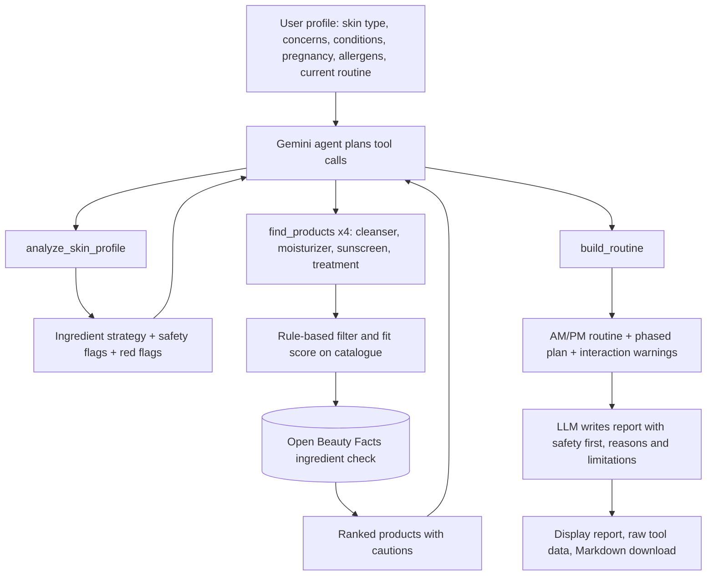

# SkinPilot workflow schema

## Flowchart



## JSON workflow schema

```json
{
  "project": "SkinPilot",
  "version": "1.0",
  "type": "agentic_skincare_research_assistant",
  "input": {
    "skin_type": ["Oily", "Combination", "Normal", "Dry", "Sensitive"],
    "concerns": "multi-select from 7 concerns",
    "diagnosed_conditions": "optional",
    "pregnant_or_breastfeeding": "boolean",
    "avoid_list": "free text",
    "current_routine": "free text"
  },
  "components": [
    {"id": "research_agent", "type": "llm_agent", "framework": "LangChain + Google Gemini"},
    {"id": "analyze_skin_profile", "type": "tool", "operation": "concern_to_ingredient_priority + irritation_cap + pregnancy_rules"},
    {"id": "find_products", "type": "tool", "operation": "filter_score_rank_catalogue + open_beauty_facts_label_check"},
    {"id": "build_routine", "type": "tool", "operation": "am_pm_assignment + interaction_rules + phased_introduction"}
  ],
  "control_flow": [
    "user -> research_agent",
    "research_agent -> analyze_skin_profile -> research_agent",
    "research_agent -> find_products (x4 parallel) -> research_agent",
    "research_agent -> build_routine -> research_agent",
    "research_agent -> report -> user"
  ],
  "guardrails": [
    "No diagnosis; red flags and when to see a doctor shown first",
    "Pregnancy exclusions and irritation caps applied in code",
    "Allergen and fragrance filters applied in code",
    "No product, strength or fact outside tool output",
    "Raw tool data shown for verification",
    "Fallback to other Gemini models when free quota is exhausted"
  ]
}
```
